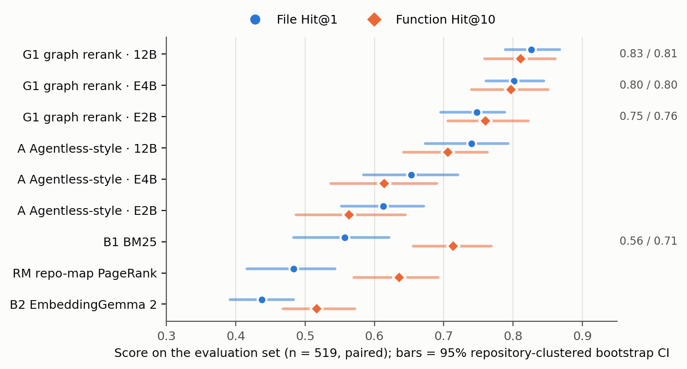
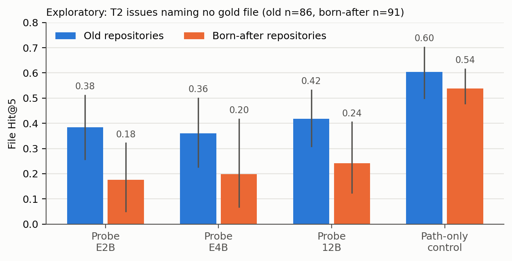

# Born After the Cutoff

### A localization benchmark for small Gemma 4 coding agents, dated against the model's own training timeline

## Abstract

Before a coding agent can fix an issue it has to find where to change the code, and the repositories used to measure this are ones today's models have probably seen in training. We release a localization resource that controls for this in two ways. Its 4,097 issue-to-fix instances, from 26 permissively licensed Python agent and LLM-framework repositories, are split into three tiers by issue date relative to Gemma 4's stated pre-training cutoff (January 2025) and public release (April 2026). And 1,790 of them come from six repositories that did not exist before the cutoff, so their code cannot have been memorized.

Gold files and functions come from the landed diff; an audit of 60 instances, performed by an LLM-based research agent (Claude), found 95% of the gold labels correct (Wilson 95% CI 86 to 98%). Code graphs follow the NetworkX node-link layout that the Gemma 4 Developer Agent competition documents publicly. We report no-LLM baselines (BM25, dense retrieval with EmbeddingGemma 2, and a repo-map PageRank) and four Gemma 4 methods.

On a pre-registered evaluation set of 519 instances, a single-call graph rerank (G1) with Gemma 4 E4B reaches file Hit@1 0.80 and function Hit@10 0.80, against 0.56 and 0.71 for BM25; 12B reaches 0.83 and 0.81. G1 beats an Agentless-style prompt by +0.23 function Hit@10 for both E2B and E4B (Holm-corrected p = 0.0002), and it beats a 12-step tool-using graph agent at a tenth of the tokens. Two pre-registered predictions failed: the graph's gain is no larger on unseen codebases, and a memorization probe shows no tier effect beyond guessability. An exploratory analysis points to a codebase-familiarity effect that only the born-after split can show.

## 1. Problem and motivation

Localization, choosing the files and functions to edit, is the first step of every issue-fixing agent, and its errors carry through to the patch. Agentless [1], LocAgent [2], CoSIL [3] and SweRank [4] all show how much the end result depends on it.

For small local models this step is hard to measure cleanly. Public benchmarks reuse popular repositories, models can recall file paths from issue text alone [5], and they lean on repository structure they already know [6]. Live collections such as SWE-bench-Live [7] and SWE-rebench [8] refresh their tasks over time, but they score resolution rather than localization, and they are dated by calendar rather than by a given model's training timeline.

The Gemma 4 Developer Agent competition supplies code graphs and a similarity tool. Its public page says the tool "finds top-k graph nodes with highest cosine similarity to `query` in the pre-computed embeddings" and powers "offline semantic code retrieval". Computed on the main track's public dev data, most of the 129 dev tasks were created after Gemma 4's pre-training cutoff, while all four dev repositories were created between 2011 and 2019. Agents tuned on those tasks therefore work in codebases the model knows, and the hidden test set comes from private repositories. A public set of unfamiliar codebases lets participants and researchers measure that gap.

We ask three questions. Can such a set be built automatically and audited? Does graph structure help small Gemma 4 models localize? Can memory be separated from skill?

## 2. Related work

SWE-bench [9] and its live successors [7, 8] score resolution, and SWE-Bench+ [10] reports fixes leaked in issue text. Loc-Bench [2] (560 instances, bugs after October 2024), Long Code Arena's bug localization task [11] and SWE-PolyBench [12] report retrieval metrics. IssueLoc-Bench [13] and SemNav [14] already use Gemma 4 E4B as a localizer. AgentIssue-Bench [15] studies agent-framework issues but evaluates resolution only. Graph-guided localization includes LocAgent [2], CoSIL [3] and RepoGraph [16], and our RM baseline is inspired by aider's repo-map [17]. What we add is the combination: tiers dated against one model family, a control at the level of whole codebases, the agent-framework domain, a format compatible with the competition, and a pre-registered analysis.

## 3. The resource

The sources are 26 MIT, Apache-2.0 or BSD repositories. Most are agent and LLM frameworks (openai-agents-python, pydantic-ai, fastmcp, microsoft/agent-framework, langgraph, crewAI, dspy, haystack, livekit agents, pipecat and others). The competition's four public repositories are also included, harvested independently from GitHub; we never redistribute any competition file. Six repositories were created after January 2025: openai-agents-python, strands, agent-framework, a2a-python, adk-python and OpenMinion.

Merged pull requests are linked to the issue they close, through GitHub's `closingIssuesReferences` or, failing that, closing keywords in the PR body. Repositories synced with Copybara close issues with direct commits, so a separate commit linker adds adk-python (498 instances). We keep an instance when the issue predates the fix, neither issue nor PR is written by a bot, the fix modifies 1 to 5 core files and at most 400 core lines, tests change, the fix is not trivial or documentation-only, and the issue does not contain the diff.

Gold files are the modified pre-existing core files of the landed diff, that is, the merge commit against its first parent. For gold functions, changed old-side lines are mapped with Python's `ast` to the innermost top-level function, class or method. A new method credits its class and a nested helper credits its enclosing function. Instances where most of the changed code is new are flagged (2.7%), as are issues filed more than a year before their fix.

Tiers follow the issue date: T0 before 2025-02-01 (282 instances), T1 up to the release (1,390), and T2 after 2026-04-02 (2,425). Post-training data cannot contain T2 issues.

The reporter is also the fixer in 36% of instances, and many issues are filed minutes before the fix. Issues name a gold file in 41% of instances and a gold function in 60%. We therefore define an independent subset (a different author, an issue filed at least 24 h before the fix, no quoted fix code) of 1,765 instances.

An LLM-based research agent (Claude) labelled 60 stratified instances against a fixed rubric, and no human reviewed its labels. Gold was correct for 57 of 60 (95.0%, CI 86.3 to 98.3%); the errors were one linking mistake, one fix made mostly of new code and one fix to a module-level constant, which function-level gold cannot credit. 55% of the issues were prescriptive, naming the exact location or change. The audit also found four bugs in the extractor (an appended function credited to its neighbour, a file leaking in from a stacked PR, re-wrapped signatures, and definitions inside module-level `try` blocks). Each was fixed with a regression test, and all gold was regenerated before any model run.

The release contains the task labels without issue text (CC BY 4.0, with source URLs) and the issue text with mentions, e-mail addresses, home-directory names and credential-like strings masked. It also contains code graphs in NetworkX node-link JSON with the publicly documented fields (`id`, `name`, `source`, `target`, `type`, `key`) plus module nodes and typed edges (calls, contains, imports, inherits). Node text, which is upstream source code, is left out and rebuilt from GitHub by our builder at the pinned commits. The harvester is included, so new tiers can be built for future models.

## 4. Tasks, metrics and methods

Given an issue and the repository at the base commit, a method ranks files and functions. We report Hit@k (at least one gold item in the top k), Acc@k (all gold items in the top k), MRR, prompt tokens and seconds, with CIs from 1,000 bootstrap resamples clustered by repository.

There are four no-LLM baselines. R0 is a random order plus BM25 over file paths alone, which serves as a guessability control. B1 is BM25 over file content and over AST units. B2 is EmbeddingGemma 2 [18] truncated to 256 dimensions, ranking each file by its best unit. RM runs personalized PageRank over our code graph, seeded by code-like identifiers in the issue.

The Gemma 4 methods [19] use E2B, E4B and 12B as instruction-tuned QAT checkpoints, served by Ollama on one Kaggle T4 with a 16k context and thinking off:

- P sees only the issue, no repository, and names 5 paths. It is a memorization probe in the spirit of [5].
- A follows Agentless [1]: from the file list it picks 5 files, then reads skeletons of the top 3 and names functions.
- G1 expands the B1 and B2 seeds by one hop over calls, inherits and contains edges into a pool of at most 40 units, which Gemma reranks in one call.
- G2 is an agent with the competition's three graph-tool signatures plus `read_file`, limited to 12 steps.

From the B1 top-10 seeds, one hop reaches 58.2% of gold functions, against 38.6% at zero hops, with a median pool of 59 units.

Hypotheses, strata, metrics and exclusions were committed before any Gemma run on evaluation instances. The changes that followed a 30-instance pilot (output parsing, prompt examples, at least two tool calls before G2 may answer) and a 200-instance G2 subsample chosen for budget reasons were logged before the evaluation runs. The evaluation set has 519 instances: 400 T2 instances in `main` (200 born-after, 328 independent), 19 curated OpenMinion instances reported separately because the authors filed and fixed those issues, and 100 T0 instances from older repositories.

## 5. Results

**Table 1.** Paired results, n = 519.

| Method | File Hit@1 | File Hit@5 | Function Hit@10 | Median prompt tokens |
|---|---|---|---|---|
| B1 BM25 | 0.557 | 0.800 | 0.714 | 0 |
| RM (graph, no LLM) | 0.484 | 0.800 | 0.635 | 0 |
| B2 EmbeddingGemma 2 | 0.437 | 0.744 | 0.517 | 0 |
| P, E2B / E4B / 12B | 0.516 / 0.532 / 0.561 | 0.572 / 0.570 / 0.609 | n/a | 864 / 864 / 868 |
| A, E2B / E4B / 12B | 0.613 / 0.653 / 0.740 | 0.805 / 0.813 / 0.877 | 0.563 / 0.614 / 0.706 | 8,096 / 7,938 / 8,061 |
| G1, E2B / E4B / 12B | 0.748 / 0.801 / 0.827 | 0.871 / 0.896 / 0.911 | 0.760 / 0.797 / 0.811 | 3,063 / 3,063 / 3,067 |

BM25 is a strong floor, and RM matches its file Hit@5 using nothing but the graph and identifiers from the issue. Path-only BM25 already reaches file Hit@5 0.586 and random ordering 0.054. Dense retrieval loses overall but wins on the older T0 issues (Hit@5 0.730 vs 0.650), where there are fewer lexical cues. Across all 4,097 instances, BM25 Hit@5 falls from 0.854 on T2 to 0.725 on T1 and 0.610 on T0.

G1 is the strongest method in every subset we report. That includes issues that name no gold file, where G1 with E4B scores file Hit@1 0.717 against 0.450 for BM25. It uses fewer than half of A's tokens and takes about 1.6 s per instance with E2B, 2.8 s with E4B and 9.2 s with 12B on a T4.

On the 200-instance G2 subsample, the agent is much weaker than the single-call rerank. Its function Hit@10 is 0.365 with E2B and 0.465 with E4B, against 0.805 and 0.825 for G1 and 0.755 for BM25, at a median of 26.6k and 33.9k prompt tokens against about 3.1k for G1. Its tool calls are mostly valid (86% with E2B, 97% with E4B), so the problem is not the protocol: the small models stop exploring early and name few functions. G2 with 12B scores 0.355, below E4B. Its tool calls are 99% valid and it explores longer, but 98 of 200 runs reach the 12-step limit without naming any function, at a median of 99.1k prompt tokens. On the 102 runs where it does answer, it reaches 0.696, against 0.843 for G1 with 12B on the same instances (exploratory).

**Pre-registered hypotheses.**

- H1, memory beyond guessability, is not supported. We tested whether the probe's margin over the path-only control is larger for old-repository T0 issues than for born-after T2 issues. The difference is −0.115 for E2B, −0.125 for E4B and −0.060 for 12B, and every CI includes 0. The probe's success follows the file names written in the issue, which T2 issues contain more often.
- H2, that the graph helps, is supported. On independent ∩ main (n = 325), G1 beats A on function Hit@10, 0.785 vs 0.551 with E2B and 0.840 vs 0.612 with E4B (Holm p = 0.0002). The predicted larger gain on born-after repositories did not appear: the interaction is −0.048, with CIs spanning 0.
- H3, that the gain shrinks with model size, holds descriptively. G1 − A is 0.210 for E2B, 0.203 for E4B and 0.129 for 12B (CI 0.077 to 0.190), because 12B's Agentless prompt closes part of the gap.
- H4, the cost-accuracy comparison, is supported. On the G2 subsample, G1 with E2B reaches function Hit@10 0.805 at 3.1k median tokens, ahead of G2 (0.365 at 26.6k) and A (0.580 at 8.6k).
- H5 predicted that masking identifiers in the issue would hurt more when the issue names the gold file. Masking cuts BM25's file Hit@5 from 0.853 to 0.453 on `main`, by 0.39 to 0.41 whether or not the file is named. For A with E4B it falls from 0.825 to 0.422, and the drop is larger when the file is named (0.46 vs 0.33), but the interaction CI includes 0 (−0.03 to 0.28). The interaction is not supported, while identifiers clearly carry most of the localization signal for BM25 and Gemma alike.

**Exploratory, not pre-registered.** Restricting the probe to T2 issues that name no gold file keeps issue dates comparable and removes the most obvious lexical cue. Without seeing the repository, the models find a gold file in the top 5 for 0.384, 0.360 and 0.419 of old-repository issues (E2B, E4B, 12B) and for 0.176, 0.198 and 0.242 of born-after issues. That is a gap of 0.16 to 0.21, while the path-only control, which does see the real file list, differs by 0.07 (0.605 vs 0.538). The per-model CIs are wide and overlap, but the direction is the same for all three models. This is the familiarity effect that a split by date alone cannot remove and that the born-after control was built to measure.

## 6. Limitations

The gold audit was performed by an LLM-based research agent (Claude), the same assistant that wrote the pipeline, and no human checked its judgements, so the audit is not independent of the extractor it validates. Every error it found was fixed in code rather than relabelled. Gold is the fix that landed, so valid alternative locations count as misses; Hit@k softens this and Acc@k does not. The G2 subsample (200) and the T0 cell (100) limit statistical power, and T0 also contains older, terser issues, so tier and issue style are confounded there. Many issues name their own fix location, which is why we report the independent and no-mention subsets. Results use 4-bit QAT GGUF checkpoints served by Ollama, while the competition harness serves different quantized checkpoints, so absolute numbers may shift. The 19 OpenMinion instances come from issues the authors filed and fixed; they are analysed separately and never pooled.

## 7. Verifiability

All code is released under Apache-2.0: the harvester, gold extraction, graph builder, baselines, Gemma runners and analysis, with 37 unit tests. The dataset holds the labels, issue text, flags, the audit sheet, and the evaluation, pilot and G2 id lists. We keep every model output with its token count and latency, the exact model tags and digests, pinned library versions, seeds and prompt templates. A public Kaggle notebook rebuilds every table, test and figure from the released outputs on CPU and checks each against the reference results; the kernel scripts that ran Gemma on a T4 are in the repository. The pre-registration and its deviation log are versioned with commit hashes.

## AI assistance

The pipeline code, the analyses and the drafting of this writeup were done with an AI coding and research assistant (Claude), directed and reviewed by the authors. The same assistant performed the gold audit described in §3.

## References

1. Xia et al. *Agentless: Demystifying LLM-based Software Engineering Agents.* FSE 2025. https://arxiv.org/abs/2407.01489
2. Chen et al. *LocAgent: Graph-Guided LLM Agents for Code Localization.* ACL 2025. https://arxiv.org/abs/2503.09089
3. Jiang et al. *CoSIL: Issue Localization via LLM-Driven Iterative Code Graph Searching.* ASE 2025. https://arxiv.org/abs/2503.22424
4. Reddy et al. *SweRank: Software Issue Localization with Code Ranking.* ICLR 2026. https://arxiv.org/abs/2505.07849
5. Liang et al. *The SWE-Bench Illusion: When State-of-the-Art LLMs Remember Instead of Reason.* 2025. https://arxiv.org/abs/2506.12286
6. Chen et al. *Schrödinger's Code Repository: Have LLMs Learned SWE-bench or Memorized It?* 2026. https://arxiv.org/abs/2609.27891
7. Zhang et al. *SWE-bench Goes Live!* 2025. https://arxiv.org/abs/2505.23419
8. Badertdinov et al. *SWE-rebench.* NeurIPS 2025 Datasets & Benchmarks. https://arxiv.org/abs/2505.20411
9. Jimenez et al. *SWE-bench: Can Language Models Resolve Real-World GitHub Issues?* ICLR 2024. https://arxiv.org/abs/2310.06770
10. Aleithan et al. *SWE-Bench+: Enhanced Coding Benchmark for LLMs.* 2024. https://arxiv.org/abs/2410.06992
11. Bogomolov et al. *Long Code Arena.* 2024. https://arxiv.org/abs/2406.11612
12. Rashid et al. *SWE-PolyBench.* 2025. https://arxiv.org/abs/2504.08703
13. Al Awad & Ivanov. *Cost-Effective Repository Exploration for Agentic Issue Localization.* 2026. https://arxiv.org/abs/2608.29675
14. Wei et al. *Semantic Navigation for Issue Localization in Code Repository.* 2026. https://arxiv.org/abs/2609.31176
15. Rahardja et al. *Can Agents Fix Agent Issues?* NeurIPS 2025. https://arxiv.org/abs/2505.20749
16. Ouyang et al. *RepoGraph.* ICLR 2025. https://arxiv.org/abs/2410.14684
17. Aider. *Repository map.* https://aider.chat/docs/repomap.html
18. Google DeepMind. *EmbeddingGemma 2* model card, 2026. https://huggingface.co/google/embeddinggemma-2
19. Gemma Team. *Gemma 4 Technical Report.* 2026. https://arxiv.org/abs/2607.02770
